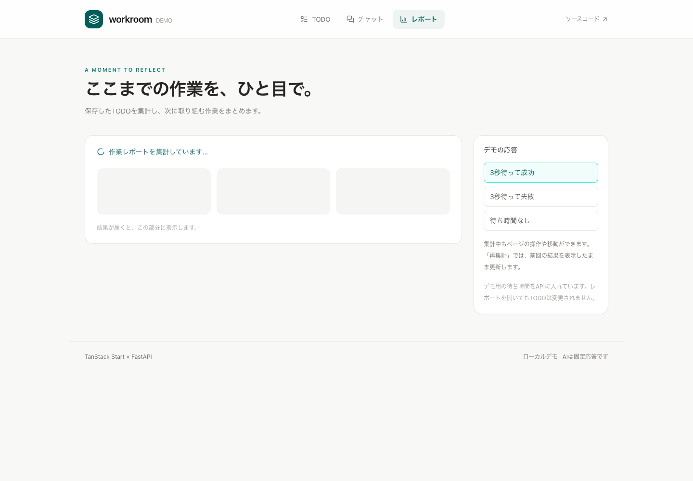
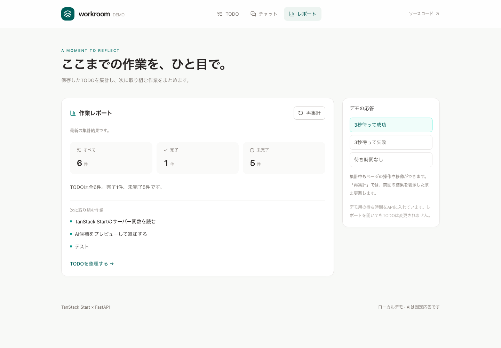

# 待ち時間のある画面を、取得用のstateなしで作る

`/reports` は保存済みTODOを集計する画面です。Python APIの `asyncio.sleep(3.0)` で実際のHTTP応答を遅らせ、待機中の表示を確認できます。ブラウザのタイマーで結果表示だけを遅らせる実装ではありません。

## 操作と表示

1. ナビゲーションから「レポート」を開く。見出しと応答の切り替え欄が先に表示され、集計欄だけが待機表示になる。
2. 約3秒でTODOの総数・完了数・未完了数と、次の未完了TODOが届く。
3. 「再集計」を押す。前回の結果を残しながら更新中を表示し、ボタンは処理中だけ無効になる。
4. 「3秒待って失敗」を選ぶ。待機の後、集計欄にエラーを表示する。「もう一度試す」または「待ち時間なし」で次の取得を試せる。
5. TODO画面でも候補の応答を「3秒待って成功／失敗」にすると、ボタンのpending・入力無効化・結果またはエラーを試せる。

レポートは読み取りだけです。TODOの追加・編集・削除・完了切り替え後は、TODO一覧とレポートのQueryを無効化します。キャッシュが新鮮な間の再訪はすぐに表示されます。初回待機を繰り返すならページを再読み込みし、既存結果を残す待機を試すなら「再集計」を使います。

## 実画面





## 読むコード

| 場面                     | 状態の持ち主                           | 実装                                                                          |
| ------------------------ | -------------------------------------- | ----------------------------------------------------------------------------- |
| URLと取得開始            | Routerのsearch / loader                | [reports route](../apps/web/src/routes/reports.tsx)                           |
| 初回の結果待ち           | React Suspense                         | [ReportPageとReportPending](../apps/web/src/features/reports/report-page.tsx) |
| 結果・再取得中・エラー   | Queryのdata / isFetching / error       | 同ファイルのReportResult                                                      |
| 失敗からの再試行         | QueryErrorResetBoundaryとCatchBoundary | 同ファイルのReportPage                                                        |
| 候補の送信中・成功・失敗 | mutationのisPending / data / error     | [SuggestionPanel](../apps/web/src/features/todos/todo-page.tsx)               |
| サーバー境界と型         | Start Server Function                  | [getSummaryReport](../apps/web/src/server/functions/reports.ts)               |
| 実際の待ちと集計         | FastAPI・PostgreSQL                    | [summary_report](../services/api/src/demo_api/main.py)                        |

取得を管理する中心は、次の短い組み合わせです。表示のマークアップ、URL切り替え、エラーの再試行UIは実装ファイルにあります。

```tsx
// route loader: 完了を待たずに取得を開始。prefetchQueryは失敗をthrowしない。
loader: ({ context, deps }) => {
  void context.queryClient.prefetchQuery(reportOptions(deps.scenario));
};

// 初回はこの領域だけ待機表示
<Suspense fallback={<ReportPending />}>
  <ReportResult scenario={scenario} />
</Suspense>;

// ReportResult: データがある再取得ではSuspenseへ戻らず、前回の結果を残す
const { data, isFetching, error, refetch } = useSuspenseQuery(reportOptions(scenario));
```

新しいレポート画面には、取得のための `useEffect`、`useState`、手動の `setLoading(true/false)` を置いていません。候補生成も `suggest.isPending` から表示を決め、loading専用stateは追加していません。入力や編集のためのstateとは役割が異なります。

Queryキーは `['reports', 'summary', scenario]`。条件をURL・loaderDeps・Queryキーに揃え、別の応答条件のキャッシュを混ぜません。成功結果は30秒キャッシュし、このデモは `retry: false` で失敗を自動反復しません。SSRのQueryClientは既存のRouterごとのインスタンスを使います。

## 説明するときに分けること

**待機表示と取得状態を手書きしない効果は、React・Router・Queryの組み合わせによるものです。** Startは、SSRとブラウザから同じ型付き関数でFastAPIへ接続する境界を提供します。Next.jsでもSuspenseやQueryを使えます。[QueryのSuspense](https://tanstack.com/query/latest/docs/framework/react/guides/suspense)、[Routerの遅延データ](https://tanstack.com/router/latest/docs/framework/react/guide/deferred-data-loading)

従来のTODO loaderは一覧を待ってから画面を表示します。今回のレポートloaderは待たず、ページ内のSuspense境界で待ちます。重要なデータを先に揃える画面と、一部を後から埋める画面の両方をコードで確認できます。

候補を作る操作は `useMutation`、画面を表示するための取得は `useSuspenseQuery` を使っています。非同期処理をすべて同じフックへ寄せる例にはしていません。

## 待機と保存の境界

3秒の待機はHTTPリクエスト内でのデモ用処理です。待機中にイベントループやDB接続を占有せず、他のTODO操作が応答することをAPIテストで確認します。数分以上かかる仕事の永続ジョブ化や、画面を閉じた後の処理継続は別の要件です。

チャットのスレッド・会話履歴のDB保存は追加していません。

採用版の注意点として、初回SSR中にSuspense内の取得が失敗すると、Reactはその領域をブラウザで再評価します。その際にAPIを再呼び出すため、直接失敗URLを開いた場合はエラー表示まで約6秒かかることがあります。これはQueryの`retry: false`とは別のSSR回復動作です。画面内の条件切り替えや「もう一度試す」では1リクエスト分の約3秒で確認できます。
