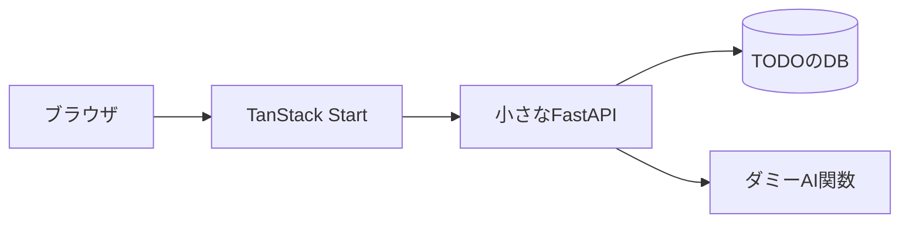
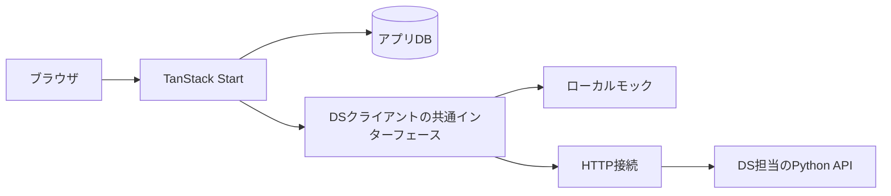

# TanStack Startの構成を検証する全体計画

新規案件で使う技術と構成を選ぶために、TODO管理、AIによるTODO候補提案、ストリーミングするAIチャットを備えた紹介用アプリを作る。AIはすべてダミーとし、実モデルなしで起動できるようにする。案1はTanStack Startのサーバー機能の導入しやすさをNext.jsと比べ、案2はアプリとDS APIの責任分担と、モックを使った独立開発を示す。

それぞれ独立した新しいモノレポとして作成し、そのリポジトリだけで起動、機能の体験、コードの理解ができる状態にする。既存テンプレートのコピーや既存リポジトリへの依存を前提にせず、新規に実装する。Cookiecutterや既存案件の移行は計画の対象に含めない。

このリポジトリ（tanstack-start-fastapi-demo）では**案1だけを実装する**。実装手順は [このリポジトリの実装計画](implementation.md)、配信仕様は [ストリーミング共通契約案](streaming-contract.md) を参照する。もう一方の案は構成を比較する背景情報であり、このリポジトリ内に二案を実装することは求めない。まず紹介用アプリを完成させ、そのコードと画面を使って説明用HTMLを作る。空の雛形よりも、便利な機能の使い方を具体的に示すことを優先する。

## AWS配置の追加計画

ローカル紹介版の完成後、2026-10-18にAWS上の小規模デモ環境の計画を追加した。利用者の希望は簡潔・低コストと、関係者のIPへの限定。30分以内を目標に検証後destroyする条件が加わったため、ECSをprivate subnetへ配置する一時環境案へ更新した。Web/APIは同一クラスター内の2サービスに分離し、Service Connectで通信しながら個別に更新・スケールする計画とする。構成とTerraformの実装範囲は [AWSデモ環境の計画](aws-infrastructure.md) を参照する。まだAWSリソースとTerraformコードは作成していない。

## 背景と目的

Next.js、FastAPI、PostgreSQLを組み合わせ、画面を主にクライアント側で実装する構成では、データ取得にuseEffectを使い、取得状態や更新後の再取得を個別に管理する場面がある。サーバー機能の導入に必要な概念と手順を整理し、チームが扱いやすい構成を検証する。

TanStack Startでは、必要な処理をServer Functionsとして定義し、画面やloaderから利用する方法が採れる。この作法がチームにとって理解しやすいか、少ない学習で便利なサーバー機能を導入できるかを、動くアプリと具体的な変更作業で確かめたい。

また、PythonやローカルLLMを使う案件では、SWEがDSのロジックを受け取り、アプリのバックエンドへ組み込む負担がある。業務データと画面をアプリ側で管理し、DSが提供するAPIを利用する構成なら、入出力の合意を境界に開発を分担できる。APIが未完成でもモックでアプリ開発を進められることも、案2で示したい価値である。

## 二つの案で示すこと

| 観点 | 案1 | 案2 |
| --- | --- | --- |
| 主題 | Startでサーバー機能をどれだけ自然に使えるか | アプリとDSを分けて開発できるか |
| アプリの構成 | Startと最小限のFastAPI | Startの業務処理と独立したDS API |
| TODOの保存 | FastAPI側 | Start側 |
| AIの呼び出し | Startのサーバー関数からFastAPIへ | StartのDSクライアントからモックまたはPython APIへ |
| 紹介の見どころ | 関数呼び出し、型、loader、Query、サーバー専用設定 | DB所有、API契約、モックとHTTP実装の交換、担当範囲 |
| 比較対象 | 同じ処理をNext.jsで書く説明用コード例 | 同じUIでのmockモードとhttpモード |
| 成果物 | 機能が入った独立モノレポ | 機能が入った独立モノレポ |

案1のFastAPIはデモを成立させるための最小限の脇役とし、アーキテクチャ改善、認証基盤刷新、ジョブ基盤、運用改善を実装テーマにしない。両案に本格的なワーカーや再試行基盤を揃えることも、最初の完成条件にはしない。

## ライブラリの方針

両案でUI、フォーム、型生成などの周辺条件を揃える。Next.jsのアプリは作らず、説明用コード例では同等の処理と条件を示す。開発ツールとチャットSDKの更新はフレームワークの利点と分けて説明する。

| 用途 | 方針 | 状態 |
| --- | --- | --- |
| UIの基本 | ReactとReact DOMの19系 | 採用 |
| Startのビルド | Vite | 採用 |
| TypeScript | 7系を基準にし、ビルドとコード生成の互換性を最初に確認する | 採用方針 |
| 単体テスト | Vitest | 採用 |
| ブラウザテスト | Playwright | 採用 |
| UI部品 | shadcn/uiとBase UI | 採用 |
| CSSとアイコン | Tailwind CSS 4とLucide | 採用 |
| 案1のPython API | FastAPI、Pydantic、Uvicorn、AG-UI Python SDK。TODOのDB操作はSQLAlchemyとAlembicの系統を使う | 最小限の構成 |
| 案2のPython API | FastAPI、Pydantic、Uvicorn、AG-UI Python SDK。アプリDBへは接続しない | DS担当範囲 |
| 案2のDB | PostgreSQL、Drizzle ORM、pg、Drizzle Kit | 採用 |
| LinterとFormatter | OxlintとOxfmt。React、Hooks、アクセシビリティ等の必要なルールを確認する | 採用 |
| 型チェック | oxlint-tsgolintを追加し、Oxlintのtype-awareとtype-checkでLintへ統合する | 初期検証後に統合 |
| 共有UI状態 | 必要な場合はJotaiを第一候補にする | 条件付き候補 |
| サーバーデータ | TanStack Query。Jotaiへ同じデータを複製しない | 採用 |
| フォーム | TanStack Formを両案で使う | 採用 |
| 入力検証 | Zod | 維持 |
| APIの型 | openapi-typescriptで生成し、openapi-fetchで利用する | 第一候補 |
| チャットUIと配信形式 | TanStack AIの@tanstack/ai-reactと@tanstack/ai、AG-UIの基本イベント。必要なら@tanstack/ai-clientも追加する | 初期導入。RCの互換性と配信を初期検証 |
| 認証 | 初期は未導入。後からアプリ内認証を加える場合はBetter Authを第一候補にする | 追加時の候補 |
| JSとPythonの依存管理 | Node.js 24系、npm workspaces、Pythonとuv。Pythonの品質確認はpytestとRuff等 | 共通方針 |

Jotaiは共有するUI状態に限定し、フォーム値はフォームライブラリ、一覧と取得状態はQuery、絞り込みはURLで扱う。SSRではProviderでストアを分離する。認証を追加しても、認証の正本をJotaiに置かない。

チャットのメッセージ、送信中、受信中、停止、エラーは採用するチャットSDKで管理し、同じ状態をQueryやJotaiへ複製しない。フォームライブラリは入力欄の検証を担当する。実AIを呼ばないため、モデルプロバイダー用のSDKは初期に追加しない。

### チャットSDKの選定理由

TanStack AIは初期から導入する。案件でチャットや途中配信が不要なら、関連画面と依存を削除できる形にする。通常のTODO CRUDやJSON APIはチャット機能に依存させない。Startのサーバー関数をuseChatのfetcherへ接続する方法が公式にあり、TODOとチャットの両方でサーバー関数を使う体験を示せる。AsyncIterableやSSEを受け取れるため、DS APIとサーバー内モックを共通インターフェースで扱う今回の構成にも合う。この適合性は設計上の判断であり、実装量や性能の優位性を検証済みとは扱わない。[Server Functionsとの接続](https://tanstack.com/ai/latest/docs/transports/server-functions)、[配信方式](https://tanstack.com/ai/latest/docs/transports/overview)

2026年10月17日の確認では、TanStack AIの公式トップはRC表記である。Startの安定版採用とAIライブラリの成熟度を混同せず、まず小さな配信で途中表示、正常終了、エラー、停止の伝播、TypeScriptとの互換性を確認して、動作するバージョンを固定する。SDKの全機能や本番利用を一括採用する判断にはしない。[TanStack AIの公開状態](https://tanstack.com/ai/latest)

Vercel AI SDKでもPython接続、ストリーミング、独自Transportを実現できるため、DS分離はTanStack AIだけの強みではない。TanStack AIを選ぶ主な理由は今回示したいStartの関数呼び出しとの相性である。必要な動作に支障があればAI SDKを再検討できるよう、DS契約とSDKへの変換を分けておく。[AI SDKのTransport](https://ai-sdk.dev/docs/ai-sdk-ui/transport)、[他言語サーバーとの接続](https://ai-sdk.dev/docs/ai-sdk-ui/stream-protocol)

OxlintとOxfmtの設定は旧Biomeの設定を機械的に置き換えるのではなく、必要なルールと整形方針を揃える。フォーム変更による差は、Startそのものの差として紹介しない。[Oxlintのルール群](https://oxc.rs/docs/guide/usage/linter/plugins)、[Oxfmt](https://oxc.rs/docs/guide/usage/formatter.html)、[Better AuthとStart](https://better-auth.com/docs/integrations/tanstack)

### 型チェックとビルドの確認

TypeScript 7は2026年7月8日に正式公開された。型チェックの実行はOxlintへまとめ、tscのnoEmitを毎回重ねて実行する構成にはしない。通常のLintだけ、またはtype-awareだけでは型エラーの診断を含まないため、type-checkも有効にする。

```sh
oxlint --type-aware --type-check
oxfmt --check .
```

Oxlintのtype-checkはCLI上でexperimentalとされているため、最初にアプリ、共有パッケージ、テスト、生成型を含むtsconfigの範囲を確認し、意図的に入れた型エラーを検出できることを確かめる。モノレポのパッケージ間型解決に宣言ファイルが必要なら、依存パッケージを先にビルドする。

TypeScript 7.0では旧JavaScriptコンパイラAPIが提供されない。OpenAPIの型生成など、そのAPIを使うツールは初期検証で動作を確認し、必要ならコード生成用workspaceなどへTypeScript 6の互換パッケージを限定して置く。アプリの型チェックを7系にする方針と、ツール内部の互換依存を分けて扱う。

型チェックの統合は、JavaScriptのビルド、宣言ファイルの生成、フレームワーク固有の型生成の代わりにはしない。TypeScriptの依存そのものを削除する計画ではなく、通常のチェックコマンドをまとめる計画とする。[TypeScript 7の公式発表](https://devblogs.microsoft.com/typescript/announcing-typescript-7-0/)、[Oxlintの型チェック](https://oxc.rs/docs/guide/usage/linter/type-aware.html)、[Oxlint CLI](https://oxc.rs/docs/guide/usage/linter/cli)

## 紹介するアプリの画面と機能

紹介の主役はTanStack Startとアプリ構成とし、TODOとチャットは機能を説明するためのサンプルにする。画面の題材は「作業アシスタント」とする。TODO画面で日常のCRUDとサーバー関数を示し、チャット画面で実案件に多い会話UIとストリーミングを示す。TODOと候補提案を先に完成させ、同じアプリへチャットを追加する。

| 画面 | 内容 | 見せる実装 |
| --- | --- | --- |
| /todos | TODO管理と、目的文からTODO候補を提案するフォーム | サーバー関数、フォーム、Query、永続保存 |
| /chat | ダミーAIとの会話、段階的な返答、停止、エラーと再生成 | サーバー関数による配信、チャットSDK、DS APIとモックの境界 |

### TODO管理

- TODOの一覧表示、追加、タイトル編集、完了と未完了の切り替え、削除。
- すべて、未完了、完了の絞り込み。絞り込みはURLへ反映する。
- 再読み込み後もTODOが残る永続保存。
- 空の状態、読み込み中、保存中、入力エラー、通信エラーの表示。

TODOの最小項目はid、title、completed、created_at、updated_atとする。分析依頼や実行履歴の専用テーブルは初期構成に追加しない。

### AIによるTODO候補の提案

利用者が「社内勉強会を準備したい」などの目的を入力すると、ダミーAIが「テーマを決める」「資料を作る」「参加者に案内する」といった候補を返す。利用者は候補をプレビューし、一件ずつ選んで通常のTODOとして保存する。候補の再取得だけではTODOを保存しない。

```json
{
  "request": { "goal": "社内勉強会を準備したい" },
  "response": {
    "suggestions": [
      { "title": "テーマを決める" },
      { "title": "資料を作る" },
      { "title": "参加者に案内する" }
    ],
    "model_version": "mock-v1"
  }
}
```

実際のAI、外部APIキー、GPUは不要にする。ダミー実装は固定規則と共通のサンプルデータを使い、通常応答、短い遅延、エラーを再現できるようにする。画面ではダミーAIであることを示し、実AIの品質や推論性能を示すデモとは区別する。

### AIチャットと疑似ストリーミング

- 利用者の発言とダミーAIの返答を会話形式で表示する。
- 返答はサーバーで時間差を付けて分割送信し、完了前から画面へ反映する。
- 最初の返答を待つ状態と、返答を受信している状態を分ける。
- 生成停止、再生成、最初からやり直す操作を用意する。
- 通信開始前のエラー、ストリーム途中のエラー、正常終了を区別する。
- AG-UIの工程イベントで「検索中」「回答生成中」などの途中経過も表示する。

一括取得した文字列をブラウザで少しずつ表示するだけの実装にはしない。初期の会話履歴はブラウザのメモリ内とし、リロード後の復元、再接続による途中再開、チャット履歴DB、RAG、ファイル添付、ツールによる自動TODO登録は追加段階へ分ける。既存のTODO候補提案はそのまま残す。

TanStack AIのuseChatにfetcherを渡し、Startのサーバー関数へ入力とAbortSignalを渡す方式を第一候補にする。PythonとモックはAG-UIの基本イベントを返し、サーバー関数は検証と必要な型の調整を行い、SSEのResponseまたは対応するAsyncIterableで返す。Promiseを返すStartのサーバー関数を、同期の生成器向けのstream()へそのまま渡さない。[Server Functionsとの接続](https://tanstack.com/ai/latest/docs/transports/server-functions)

最初の配信検証で、ブラウザの停止がStartの上流HTTPとPythonまたはモックの生成器まで伝わることを確認する。採用版で必要な動作を満たせない場合は、同じUIと変換処理を使い、StartのServer RouteとfetchServerSentEventsによるHTTP接続を検討する。二方式のチャットを完成品として二重実装することは求めない。[配信と中止](https://tanstack.com/ai/latest/docs/transports/overview)

型付きのストリームを返す機能はStart、会話状態とイベントからの表示更新はTanStack AIの役割として説明する。TanStack AIを使ったコードの短さを、そのままStart単体の効果にはしない。[Startの型付きストリーム](https://tanstack.com/start/latest/docs/framework/react/guide/streaming-data-from-server-functions)

最初は単一利用者のローカルデモとし、ログイン、利用者別権限、SSOは必須にしない。公開環境へ出す場合の認証とアクセス制限は別の追加作業とする。サーバー関数の入力検証と、サーバー専用情報の分離はデモでも行う。

## 案1の構成と比較方法



Startのサーバー関数で、内部APIの接続先やサーバー専用設定を扱う。loaderとQueryで一覧取得と更新後の再表示を整理し、AIの提案を呼び出す関数も画面から型付きで利用する。

チャットはTanStack AIとStartのサーバー関数を使い、FastAPIが返すダミーストリームを中継する。SDKの便利さとStartの呼び出し方を分けて紹介する。FastAPIには短いダミー生成器を追加するだけとし、ジョブ基盤は追加しない。

Next.jsの比較用アプリは作らない。アプリ完成後の説明用HTMLで、一覧取得、追加、AI提案、ストリーミングをNext.jsで書く場合の対応コードを示す。Server Components、Server Actions、Route Handlerを目的に合わせて使い、以前のuseEffect中心の実装だけを比較対象にしない。チャットの例でもTanStack AIなど同じSDKを使えるため、SDKの変更をフレームワークの差と取り違えない。

説明用コードは公式の現行仕様に照らして確認し、概念例と型チェック等を行った例を明示する。Next.jsアプリ全体の動作、実装時間、性能を実測した比較とは説明しない。

比較するのは、実行場所の分かりやすさ、関数を追加する手順、画面からの呼び出し、入力検証、取得状態、更新後の反映、型の伝わり方である。Queryを導入したことによる改善と、Start固有の作法の違いは分けて説明する。[StartのServer Functions](https://tanstack.com/start/latest/docs/framework/react/guide/server-functions)、[Queryとの連携](https://tanstack.com/start/latest/docs/framework/react/guide/tanstack-query)、[Next.jsのデータ更新](https://nextjs.org/docs/app/getting-started/updating-data)

## 案2の構成とモック開発



TODOの読み書き、AI候補の採用、業務データの整合性はStart側が担当する。DS APIは目的文から候補を生成して返し、アプリDBへ接続しない。

DSクライアントはsuggestTodosとstreamChatという共通の呼び出し口を持ち、サーバー設定のDS_MODEでmockとhttpを切り替える。mockはPythonサービスを起動せず、契約に合う候補や段階的な会話イベントを返す。httpは独立したPython APIを呼び、Python側の処理も最初はダミーにする。この二つを区別する。

画面と業務サービスは接続方式を意識せず、同じ型とエラー分類を扱う。モックとHTTP応答を同じ契約テストで確認し、DSの作業待ちでSWEの画面とDB開発が止まらないことを実演する。

DSのストリーミング契約は、AG-UIの入力と基本イベントへ揃える。独自のtext-delta、done、errorを案件ごとに設計する方針を変更し、実行の開始と終了、テキスト差分、工程、エラーを標準イベントで伝える。PythonへTanStack固有のUIMessageを持ち込まず、Startで標準の入力へ整え、必要なSDK差分だけをアダプターで吸収する。

工程とテキストを共通化し、構造化結果や追加の業務入力は案件ごとにスキーマを決める。Pythonの配信ひな形、TypeScriptのクライアント、進捗表示、モック、契約テストをセットで用意する。詳細は [DS APIのストリーミング共通契約案](streaming-contract.md) を参照する。精度上、回答全体の検証が必要なら、途中は工程のみを表示し、回答は検証後に返せる。

通常のCRUD、AI候補提案など、まとめて返すJSON応答にはAG-UIを使わず、OpenAPIの型生成を使う。実案件では途中配信が必要な箇所だけAG-UIを採用する。今回のデモにはJSON応答とストリーミングの両方を用意する。ストリーミングはイベントの型に加え、順序、正常終了、途中切断、キャンセルを契約に含める。openapi-fetchで通常のJSON応答を読む処理だけでは完結せず、HTTPストリームの読み取りとイベント検証を別に実装する。

この責任分担はNext.jsでも実現できる。Startを第一候補にする理由は、サーバー関数を明示する作法がチームに馴染むという仮説である。DSの分離やモック開発の利点を、Startだけの機能とは説明しない。

## データと担当の境界

| 対象 | 方針 |
| --- | --- |
| 案1のTODOデータ | 最小限のFastAPIが読み書きする |
| 案2のTODOデータ | Start側のアプリが読み書きする |
| 案2の少量の業務データ | Startが必要なものをDS入力へ渡す |
| BigQueryなどの大量データ | 将来必要な案件ではDS側が直接取得できる |
| DSの処理とモデル | DS担当部分としてAPIの内側へ置く |
| 案ごとのDB | 独立させ、同じテーブルを二つの実装で所有しない |

大量データ、モデル配置、長時間ジョブは将来の適用先を説明する情報として残すが、TODOデモの実装へ持ち込まない。

## 新規モノレポの方針

案1用と案2用に、Git履歴とREADMEを持つ独立したリポジトリを作る。リポジトリ名はtanstack-start-fastapi-demoとtanstack-start-ds-api-demoとする。個人アカウントで独立したリポジトリとして管理する。

案1はStart、最小限のFastAPI、UI部品と契約を含める。Next.js比較は説明用コードとHTMLにまとめ、Next.jsアプリ用workspaceは作らない。案2はStart、アプリDB関連パッケージ、DSクライアント、DS契約、Python APIを含める。モノレポはコードの管理単位であり、DS APIとアプリを別々に配置できる設計は維持する。

既存リポジトリ配下のexamplesとして作る前提は取り下げる。共通のUIやfixtureは各リポジトリに同梱し、もう一方のリポジトリや参照用リポジトリがなくても起動できるようにする。

## 実装と紹介の進め方

1. TODO、AI候補、画面操作、共通のfixtureを確定する。
2. 各案の新規モノレポで、動くTODOとダミーAI候補提案を完成させる。
3. チャットと疑似ストリーミングを追加し、途中表示、停止、エラーを確認する。
4. 案1は動いたStartのコードと、Next.jsで同じ処理を書く対応例を整理する。Next.jsアプリの実装は行わない。
5. 案2はPythonなしのmockモードからhttpモードへ切り替え、画面と業務コードが変わらないことを示す。
6. 初めて触る開発者が「AI候補の項目を追加する」などの小変更を行い、理解が必要だった概念と変更箇所を記録する。
7. スクリーンショット、構成図、対応するコード、起動手順を整理し、紹介用HTMLへまとめる。

TODOと候補提案までの完成と、チャットを含む紹介版の完成を分けて記録する。紹介版は、第三者が新しいリポジトリだけで起動し、TODOとチャットを体験し、対応するコードへたどり着けることを完成条件とする。本番運用の完成度を比較する企画には広げない。
