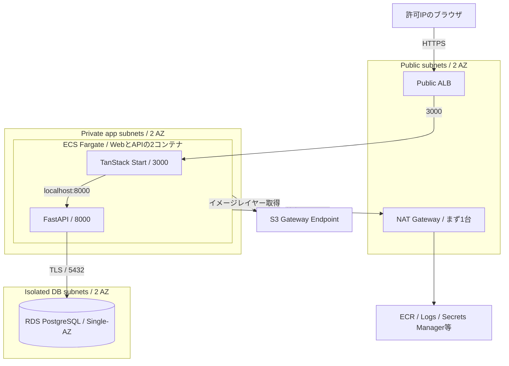

# AWSデモ環境とTerraformの構成計画

更新日: 2026-10-18。**計画段階**。Terraformコード、AWSリソース、デプロイ用CIはまだ作成していない。

現行アプリの `7cb9f85` までをmainへpush済み。この計画は、その後のローカル変更として管理する。

## 方針と前提

利用者の希望は「小規模デモ向けに簡潔・低コスト」「自分・関係者のIPに限定」。追加条件は「作成して挙動確認後、30分以内を目標にdestroyする一時環境」。常設時の月額最小化より、一般的なネットワーク分離と削除の再現性を優先する。

**Public ALB → private subnetのECS Fargate → isolated subnetのRDS**を第一候補へ変更する。WebとAPIは引き続き同一タスク内の2コンテナとし、ネットワーク分離のためだけに内部ALBやサービス間プロキシを増やさない。ECSにPublic IPは付けない。

想定リージョンは東京 `ap-northeast-1`。リージョン、AWSアカウント、接続を許可するCIDR、HTTPS方式と1回の検証予算は実装前に確定する。ネットワークは2 AZへ分離するが、NAT 1台・Single-AZ DBから始めるため、構成全体の高可用性を保証する計画ではない。

30分は検証の短い利用期間の目標とする。**apply開始からAWSの削除完了までを30分以内に保証することはできない**。特にRDSの削除時間はAWS側の内部処理によって変わる。稼働時間・destroy開始時刻・削除完了時刻を別々に記録する。

## 構成



| 部品 | 初期案 |
| --- | --- |
| Web/API | Fargate、Linux、Web/API同居のタスク。通常2タスクを2 AZへ分散して確認、最小構成は1タスク |
| タスクのサイズ | まず0.5 vCPU / 1 GiBを候補とし、NodeとPythonの同時利用を実測して増量 |
| アーキテクチャ | まずlinux/amd64に統一。Macでのビルド時もplatformを明示。ARM64は別途互換確認後 |
| 外部入口 | ALBを1台。外部から到達できるアプリはStartのみ |
| DB | RDS PostgreSQL 17系、db.t4g.micro候補、Single-AZ、gp3 20 GiBから検証 |
| ネットワーク | 1 VPC、2 AZ × Public・private app・isolated DBの3層、計6 subnet |
| 外向き通信 | app subnetからNAT Gateway 1台経由。Fargateはassign_public_ip=false。S3 Gateway Endpointも利用 |
| 証明書 | ドメインを利用する場合は同リージョンのACM証明書。DNSは既存zoneを優先 |
| 保存・保護 | 一時検証専用: RDS暗号化、backup retention 0、削除保護なし、最終snapshotを作らない。合成データだけを投入 |
| ログ | Web/APIを分けたCloudWatch Logs、保持14日を初期値候補とする |

タスク2つを配置する場合も、NAT 1台とSingle-AZ DBは単一障害点として残る。AZ障害への耐性を確認する段階では、AZごとのNATとDBのMulti-AZも別途有効にする。通常2タスク・maximum percent 200なら、更新中は最大4タスク分の余裕を見込む。

今回のNATは一般的なzonal NAT 1台を候補とし、両app subnetの外向き経路に使う。別AZからNATを利用する転送費用を見積もりへ含める。S3 Gateway Endpointをapp route tableへ関連付け、ECRのS3レイヤー取得をNAT経由から外す。ECR API/DKR・Logs・Secrets Manager等は初期はNAT経由とする。外向き経路も閉じたい検証では、必要なInterface Endpoint一式への切り替えを検討する。[S3 Gateway Endpoint](https://docs.aws.amazon.com/vpc/latest/privatelink/vpc-endpoints-s3.html)、[ECSとVPC Endpoint](https://docs.aws.amazon.com/AmazonECS/latest/developerguide/vpc-endpoints.html)

同じawsvpcタスクのコンテナはlocalhostで通信できる。AWSも、同じライフサイクルで動かすコンテナを同一タスクへ配置する選択を説明している。[タスクのネットワーク](https://docs.aws.amazon.com/AmazonECS/latest/developerguide/task-networking-awsvpc.html)、[コンテナの配置判断](https://docs.aws.amazon.com/AmazonECS/latest/developerguide/container-considerations.html)

## 通信とIP制限

| Security Group | 許可する受信 |
| --- | --- |
| ALB | 許可CIDRから443。80を使う場合も同じCIDRだけに限定 |
| Fargate task | ALBのSGから3000だけ。8000への外部ingressは作らない |
| RDS | Fargate taskおよびmigration taskのSGから5432だけ |

- ALBの接続先はタスクのprivate IP。target groupのtarget_typeは`ip`を使う。
- FargateにはPublic IPを付けない。app subnetはデフォルト経路をNATへ向け、Internet Gatewayへ直接向けない。初期化・migration用の単発タスクも同じprivate app subnetに配置する。
- Public subnetだけがInternet Gatewayへのデフォルト経路を持つ。NATのElastic IPとALBのPublic IPv4を費用へ含める。
- DB subnetにはInternet Gatewayへのデフォルト経路を置かず、RDSは`publicly_accessible=false`とする。
- `allowed_cidrs`は必須かつ空を拒否する。初期設定で`0.0.0.0/0`や`::/0`へ開かない。変動する自宅IPはTerraform変数の更新で対応する。
- ドメイン未確定なら、IP制限したALB DNS名のHTTPで一時的な接続確認はできる。通常の利用URLはHTTPSとし、ドメインまたは既存証明書を実装前に確定する。

旧案の「Public subnetのtask＋NATなし」は常設時の費用節約案として残す。今回の一時環境はprivate taskを既定とし、AWSサービスへの到達経路も確認対象にする。[Fargateの外向き通信](https://docs.aws.amazon.com/AmazonECS/latest/developerguide/networking-outbound.html)、[ALBのターゲット](https://docs.aws.amazon.com/AmazonECS/latest/developerguide/alb.html)、[RDSのVPC配置](https://docs.aws.amazon.com/AmazonRDS/latest/UserGuide/USER_VPC.WorkingWithRDSInstanceinaVPC.html)

## ECSの単位と更新

- `web`と`api`は既存Dockerfileから別々にbuildしてECRへ保存し、SHAタグとdigestで固定する。`latest`をデプロイの識別子にしない。
- Webへ `API_BASE_URL=http://127.0.0.1:8000` を渡す。Composeの`http://api:8000`をそのまま使わない。
- WebとAPIはともにessentialとし、APIの起動確認後にWebを起動する。リソース量と起動猶予は実測して確定する。
- ECS内の生存確認とDB readinessを分ける。Web用の軽い`/_health`、API用のDB非依存の`/live`を追加候補とし、既存`/health`はDBを含む疎通確認に残す。
- 通常の更新はrolling deployment。minimum healthy percent 100 / maximum percent 200、deployment circuit breakerとrollbackを有効にする。
- CloudWatchの最小限の監視はタスク停止、ALBのhealthy target・5xx、RDSストレージ等。高度な分析やContainer Insightsは費用を見て追加する。

Web/APIを一緒に更新・スケールする制約を受け入れることで、内部ALB、Service Connect、Cloud Mapの初期導入を省く。独立したチーム・リリース・負荷特性が必要になったら2サービスへ分離する。API_BASE_URLという境界はそのまま利用できる。[サービスのrolling更新とrollback](https://docs.aws.amazon.com/AmazonECS/latest/developerguide/update-service-parameters.html)

## DB認証情報と接続

Terraformで平文のDATABASE_URLやパスワードを組み立てず、タスク定義には接続先等とsecret ARNを持たせる。

- RDSの管理者パスワードはRDS管理のSecrets Manager secretを使う。これはDB初期化・migration用とする。
- 通常のAPI用に専用のDBユーザーとsecretを作る。初期化用の単発タスクが、管理者secretを利用してユーザーと必要な権限を準備する。
- API用secretの**メタデータ**はTerraformで管理し、値は初期化処理で生成・保存する。Terraformで`secret_string`を読み戻さず、値をstate、tfvars、CIログへ渡さない。初回のsecret作成からDBユーザー作成までの再実行手順も実装する。
- APIに `DB_HOST`、`DB_PORT`、`DB_NAME`、`DB_USER` と、secret参照による `DB_PASSWORD` を渡す。SQLAlchemy URL.createを使い、記号を含むパスワードも安全に扱う。
- RDS CA bundleと`sslmode=verify-full`等のTLS設定をAPI・migrationへ適用する。ローカルのDATABASE_URL方式は維持する。
- タスク起動時のsecret注入はローテーション後に自動更新されない。API用secretは初期は手動更新と新タスクへの切り替えをセットにする。自動ローテーションを足す場合は再配置またはアプリ側の資格情報再取得を同時に設計する。

execution role、通常task role、DB初期化/migration用roleを分け、管理者secretへの権限を通常のWeb/APIへ渡さない。RDSの管理者secretの自動ローテーションは、毎回新しい資格情報を取得する単発migration taskで扱う。[RDSのsecret管理](https://docs.aws.amazon.com/AmazonRDS/latest/UserGuide/rds-secrets-manager.html)、[ECSへのsecret注入](https://docs.aws.amazon.com/AmazonECS/latest/developerguide/secrets-envvar-secrets-manager.html)、[RDS PostgreSQLのTLS](https://docs.aws.amazon.com/AmazonRDS/latest/UserGuide/PostgreSQL.Concepts.General.SSL.html)

## migrationと初回起動

現在のAPI Dockerfileは起動時にAlembicを実行する。ECSでは新旧タスクが並行するため、AWS用起動コマンドはUvicornのみにし、migrationはAPIイメージを使う単発ECS taskで先に実行する。Composeの既存起動手順は維持できる。

初回の順序:

1. state管理用S3とECRをbootstrapする。
2. 現行コミットのWeb/APIイメージをbuild・pushし、digestを取得する。
3. VPC、RDS、IAM、ALB、task definition等をTerraformで作成する。サービスのdesired_countは0にする。
4. DB初期化taskでAPIユーザーとsecretを準備し、migration taskで `alembic upgrade head` を実行する。両方の終了コード0を確認する。
5. 必要なら `seed-demo` を明示実行する。毎回のデプロイでseedしない。
6. Terraformでdesired_countを2（最小検証は1）にし、ALB経由で主要フローを確認する。

通常リリースの順序:

1. Web/APIを同一Git SHAでbuildし、テスト済みdigestを固定する。
2. **稼働中サービスのimage変数は旧版のまま**、migration用imageだけ新版へ更新してTerraformをapplyする。
3. 単発migration taskを実行し、成功したらWeb/APIのimage変数を新版へ更新して再度applyする。
4. steady stateと疎通を確認する。CIを導入したら環境ごとのconcurrencyで実行を直列化する。

Terraformがサービスのtask definitionを管理し、CIが別途update-serviceして所有権を二重化する構成を避ける。DB変更は新旧アプリと互換な追加変更を優先し、アプリのrollbackがDBを自動で元に戻すとは扱わない。[ECSの単発タスク](https://docs.aws.amazon.com/AmazonECS/latest/developerguide/standalone-tasks.html)

## SSEとSSRを維持する設定

ALBからStartへはチャットのSSEとレポートのSSRをそのまま通す。初期はCloudFront、API Gateway、独自リバースプロキシを追加しない。

| 設定 | 初期候補と確認事項 |
| --- | --- |
| ALB idle timeout | 120秒。無通信のtimeoutであり、アプリの生成上限を伸ばす設定ではない |
| アプリの上限 | 現行のチャット全体60秒・無応答30秒を維持して検証 |
| target deregistration delay | 90秒を候補にし、更新中のstream終了と新規要求の振り分けを確認 |
| container stopTimeout | 最大120秒の範囲で設定し、SIGTERM時に正常終了できるか検証 |
| Node HTTP設定 | backend keep-alive/idle設定とALBの整合を採用版のNitroで確認 |

`X-Accel-Buffering: no`ヘッダーだけでAWS上の動作確認済みとはしない。実URLで、最初のチャンクが完了前に到着すること、ブラウザの停止がPythonへ届くこと、レポートの見出しが集計結果より先に届くことを確認する。[ALBの接続属性](https://docs.aws.amazon.com/elasticloadbalancing/latest/application/edit-load-balancer-attributes.html)、[Fargateの依存・停止時間](https://docs.aws.amazon.com/AmazonECS/latest/developerguide/task_definition_parameters.html)

## Terraformの配置案

次の構成を**実装時に作る**。今は.tfファイルを追加しない。

```text
infra/terraform/
  bootstrap/                  # state用S3、ECR、必要になった時点のOIDC準備
  environments/sandbox/
    backend.tf                # bootstrapしたS3を指定
    versions.tf               # 検証したTerraform/providerを固定
    main.tf                   # 各moduleの組み立て
    variables.tf
    outputs.tf
    sandbox.tfvars.example       # 値は例示。秘密情報を含めない
  modules/
    network/                  # VPC、subnet、route、SG
    database/                 # RDS、parameter/subnet group、secretメタデータ
    application/              # IAM、ALB、ECS、通常/初期化/migration task、Logs
```

- bootstrapとsandboxでstateを分ける。state用S3は暗号化、public access block、versioningを有効化する。
- S3 backendの`use_lockfile=true`を採用する。新規構成でDynamoDB lock tableは追加しない。
- state bucketはsandboxのdestroyと分けて保持する。権限を限定し、state自体も秘密情報を含み得るものとして扱う。
- image build/push、migration実行、疎通確認をTerraformのlocal-execへ詰め込まず、手順またはdeploy scriptで順に実行する。
- 主な入力はregion、project/environment、allowed_cidrs、domain/certificate、image digests、migration image digest、desired_count、CPU/memory、DBサイズ、log retention、ephemeralモード。ephemeralによる削除設定はsandbox専用とし、常設環境の既定値を変更しない。
- 出力はURL、ECR URI、cluster/service名、migration task definition、DB endpoint等。secretの値は出力しない。
- `.terraform.lock.hcl`はcommitし、state、実値tfvars、planファイルはGitへ入れない。Terraform/providerの版は実装時に確認して固定する。

S3 lockingとversioningはHashiCorp公式の現行仕様を参照する。[S3 backend](https://developer.hashicorp.com/terraform/language/backend/s3)

## 1回の検証費用とdestroy

常設730時間の見積もりから、**1回の作成・稼働・削除まで**の見積もりへ変更する。短時間のためNATを利用する判断はしやすいが、30分が各サービスの時間料金の半額になるとは限らない。

| 費用項目 | 見積もりに含めるもの |
| --- | --- |
| NAT | 1台の利用時間。1時間未満の端数も1時間分と、処理GB、別AZからの転送を考慮 |
| ALB | 1時間未満の端数も1時間分のALB料金と、LCU・Public IPv4 |
| Fargate | 通常2タスク、初期化・migration task、更新中の一時増加、イメージ取得からの時間 |
| RDS | 作成等の課金状態変更後は最短10分の秒課金。ストレージ、削除完了までの時間も考慮 |
| 周辺 | ECR、Logs、Secrets Manager、S3 state、必要なDNS、NATのElastic IP等 |

東京の現在単価と想定転送量で1回分を算出し、削除遅延・失敗時の余裕を加えた予算を決める。確定金額はまだ算出していない。[NAT料金](https://aws.amazon.com/vpc/pricing/)、[ALB料金](https://aws.amazon.com/elasticloadbalancing/pricing/)、[RDS料金](https://aws.amazon.com/rds/postgresql/pricing/)、[Fargate料金](https://aws.amazon.com/fargate/pricing/)

### 一時環境だけの削除設定

- sandboxには合成データのみ投入する。ローカルや常設DBのデータをコピーしない。
- RDSは`deletion_protection=false`、`skip_final_snapshot=true`、`backup_retention_period=0`、`delete_automated_backups=true`を候補とする。常設環境では削除保護とバックアップを有効にする別設定を持つ。
- sandbox所有のLogsはdestroyで削除する。アプリ用secretは一時環境でのみ回復待ち期間なしの削除を候補とし、RDS管理secretとの削除順序・再作成時の名前衝突も検証する。
- 共通のbootstrapにはstate用S3とECRを残せるが、**それらはsandboxのdestroyだけでは消えない**。全消去が必要なら、イメージとversioningされたstateの保存方針を決め、最後にbootstrapを別途削除する。両者の残存費用も記録する。
- リソースにはproject・environment・run_id・expires_atのタグを付け、削除対象をその実行専用のリソースへ限定する。expires_atは目印であり、タグだけでは自動削除されない。

### 短時間検証の進め方

1. Docker buildとローカルテスト、イメージpush、既存ドメイン/証明書の準備は一時環境を作る前に済ませる。
2. apply後、初期化とmigrationを実行する。検証はTODOの読み書き、SSEの途中到着・停止、レポートpending、許可IP制限を優先する。
3. 利用時間の上限で新しい検証を打ち切り、destroyへ進む。デプロイ手順は失敗時にもcleanupへ進む設計にし、CIなら常時実行のcleanup段階とrunner停止時の別の回収経路を用意する。
4. destroyが完了したか、ECS service/task、ALB/target group、NAT/EIP、RDS、Logs、secretの残存を確認する。state上で消えたこととAWS側の削除完了を照合する。
5. 削除失敗時はstateを保持し、状態を確認して再実行する。短時間制限に合わせて単にコマンドをtimeoutさせても、AWSリソースは消えない。

RDSは最終snapshotを省いても内部削除処理が残る。**作成開始から削除完了まで30分厳守**が必要なら、実測後に判定し、必要に応じてDBだけ事前作成した検証用RDSを使う構成へ切り替える。その場合は「各回の完全destroy」と異なり、共有DBが残ることを明示する。[RDSの削除](https://docs.aws.amazon.com/AmazonRDS/latest/UserGuide/USER_DeleteInstance.html)

## 他の配置案との比較

| 案 | 適する場合 | 今回の判断 |
| --- | --- | --- |
| private Fargate / 2 containers + RDS | 一時環境でネットワーク分離と挙動を確認 | 第一候補。NAT 1台・通常2タスク |
| Public Fargate / 2 containers + RDS | 常設環境でNATの固定費を削る | 旧案。今は選択しない |
| Fargate 2 services + RDS | Web/APIを独立更新・スケール | 必要になった時点でService Connect等を検討 |
| ECS Express Mode | 自動HTTPSや周辺設定の自動化を優先 | Terraform対応もある候補。今回は入口のIP制限・小さな固定構成・所有するリソースの明示を優先 |
| EC2 + Compose | 常時費用を別途比較し、OS運用も引き受ける | 選択肢として残すが、今回はサーバー管理を減らすFargateを優先 |

Express Modeを「Terraform未対応」や「同一タスクを使えない」という理由で除外しない。採用する場合はカスタムtask definitionとIP制限の管理方法を検証し、通常ECSとの二重管理を避ける。[Express Mode](https://docs.aws.amazon.com/AmazonECS/latest/developerguide/express-service-overview.html)、[カスタムtask definitionの指定](https://docs.aws.amazon.com/AmazonECS/latest/developerguide/express-service-getting-started.html)

## 実装の段階と完了条件

1. アカウント・リージョン・許可CIDR・HTTPS方式・1回の予算と、30分を計測する起点を確定する。
2. DB接続のsecret/TLS対応、health確認、migrationの分離を小さなアプリ変更として実装する。
3. Terraformのbootstrapとsandboxを作り、fmt・validate・planとdestroy planの対象範囲を確認する。
4. イメージをECRへ保存し、初期化・migration・サービス起動を行う。
5. 許可IPから主要フローを確認し、許可外の入口拒否、taskにPublic IPがないこと、appのNAT経路とDBの分離も確認する。
6. destroyと残存確認を最初の検証サイクルから行う。更新・rollback・secret更新は別の短時間サイクルに分けて確認し、作成・検証・削除の所要時間をREADMEへ記録する。
7. 手動手順が固まった後、必要ならGitHub Actionsの手動実行とOIDCを追加する。AWSの長期アクセスキーをGitHubへ保存しない。[GitHub OIDC](https://docs.github.com/en/actions/how-tos/secure-your-work/security-harden-deployments/oidc-in-aws)

AWSへのapplyと公開は次の実装段階の作業。この計画だけではAWS上の動作、料金、RDSバージョン・インスタンスタイプの選択可能性を検証済みとはしない。
